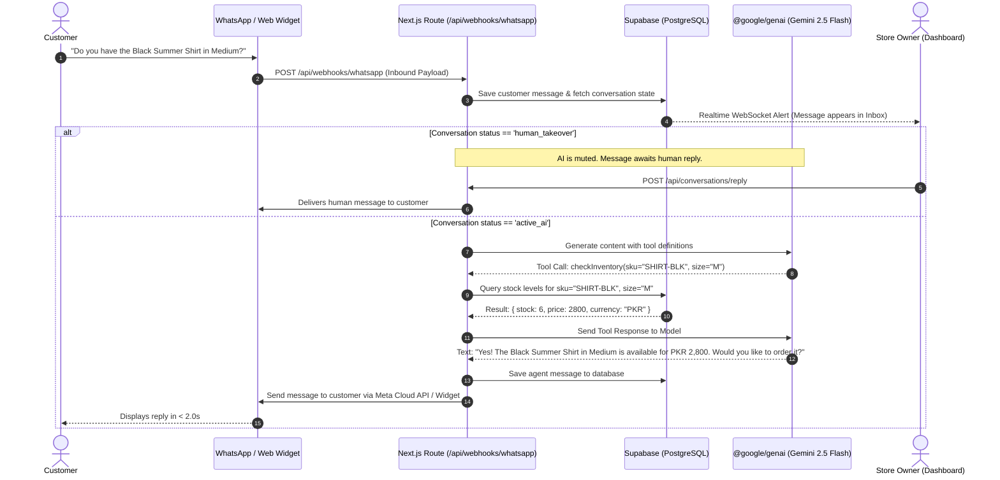
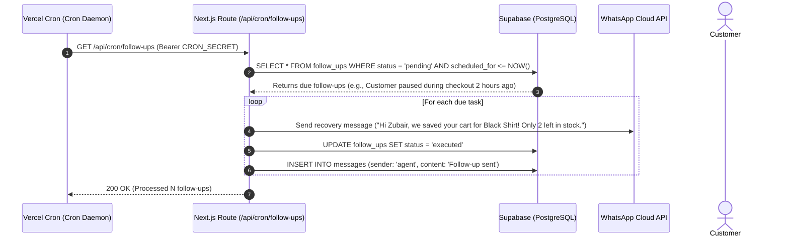

# System Architecture Document (SAD)
## AI Sales Employee — High-Level Design & Technical Specification (100% Vercel Native)

---

## 1. Architectural Philosophy & Principles

The AI Sales Employee platform is engineered for a **100% Vercel-Deployable, Zero-Cost Cloud Architecture** based on five core principles:

1. **Unified Full-Stack Next.js Monorepo:** Everything—the AI Sales Agent runtime, Meta webhook ingestion, Web Chat Widget, Merchant Live Inbox, and Database clients—runs inside a single Next.js 15 (TypeScript) application deployed to **Vercel Hobby Tier ($0/month)**.
2. **Official Google Gen AI TypeScript SDK (`@google/genai`):** High-speed, edge-compatible agent orchestration powered by Google Gemini 2.5 Flash / 2.0 Flash via Google AI Studio's permanent free tier (`GEMINI_API_KEY`).
3. **Deterministic Tool Execution & Zero Hallucination:** The agent never invents inventory, discounts, or order IDs. All operational commitments are strictly executed via typed TypeScript tool contracts against the PostgreSQL database.
4. **Serverless Cron & Event-Driven Automation:** Eliminates expensive 24/7 background worker daemons. Abandoned cart follow-ups and re-engagement messages are triggered using **Vercel Cron (`vercel.json`)** combined with Supabase `pg_cron` / Database Webhooks at zero cost.
5. **Real-time Live Takeover & Multi-Tenant Isolation:** Merchants monitor chats in real-time via Supabase Realtime WebSockets and can trigger instant 1-click human takeovers, muting the AI agent. Multi-tenancy is enforced at the database level via PostgreSQL Row-Level Security (RLS).

---

## 2. End-to-End System Architecture (100% Vercel Topology)

```mermaid
graph TD
    subgraph Client Touchpoints
        WIDGET[Web Chat Widget<br/>Storefront Script / Iframe]
        WA[WhatsApp Cloud API<br/>Meta Graph Webhooks]
        IG[Instagram Direct<br/>Phase 2 Webhooks]
    end

    subgraph Vercel Serverless Application [Full-Stack Next.js 15 App]
        subgraph Serverless Route Handlers [app/api/...]
            HOOK_WA[/api/webhooks/whatsapp<br/>Meta Verification & Ingestion]
            CHAT_API[/api/chat/message<br/>Widget Chat Endpoint]
            CRON_API[/api/cron/follow-ups<br/>Vercel Cron Trigger]
            TAKE_API[/api/conversations/takeover<br/>Human Takeover & Manual Reply]
        end

        subgraph AI Agent Runtime [@google/genai]
            AGENT_RUNNER[Agent Orchestration Loop]
            GEMINI_MODEL[Google Gemini 2.5 Flash / 2.0 Flash<br/>Google AI Studio Free Tier]
            
            subgraph Agent Tools
                TOOL_SEARCH[searchProducts]
                TOOL_STOCK[checkInventory]
                TOOL_ORDER[draftAndConfirmOrder]
                TOOL_HANDOFF[triggerHumanHandoff]
                TOOL_FOLLOWUP[scheduleFollowup]
            end
        end

        subgraph Merchant Dashboard [app/dashboard/...]
            LIVE_INBOX[Live Chat Inbox & Manual Takeover]
            CATALOG_MGMT[Product & Inventory Manager]
            ANALYTICS_UI[Revenue & Conversion Analytics]
        end
    end

    subgraph Supabase Free Tier [PostgreSQL 16 Cloud]
        DB_TABLES[(Relational Tables: Tenants, Products, Orders, Messages)]
        PG_VECTOR[(pgvector 768-dim Embeddings)]
        REALTIME_BUS[Supabase Realtime WebSockets]
        SUPA_AUTH[Supabase Auth JWT]
    end

    subgraph Scheduled Automation
        VERCEL_CRON[Vercel Cron Job<br/>Runs every 10 mins via vercel.json]
    end

    %% Ingestion Flow
    WA -->|POST Webhook| HOOK_WA
    WIDGET -->|POST Request| CHAT_API
    VERCEL_CRON -->|GET /api/cron/follow-ups| CRON_API

    %% Agent Flow
    HOOK_WA --> AGENT_RUNNER
    CHAT_API --> AGENT_RUNNER
    AGENT_RUNNER --> GEMINI_MODEL
    
    GEMINI_MODEL --> TOOL_SEARCH
    GEMINI_MODEL --> TOOL_STOCK
    GEMINI_MODEL --> TOOL_ORDER
    GEMINI_MODEL --> TOOL_HANDOFF
    GEMINI_MODEL --> TOOL_FOLLOWUP

    %% Database Operations
    TOOL_SEARCH -->|Cosine Similarity Query| PG_VECTOR
    TOOL_STOCK -->|Stock Check Query| DB_TABLES
    TOOL_ORDER -->|INSERT Order| DB_TABLES
    TOOL_HANDOFF -->|UPDATE status=human_takeover| DB_TABLES
    TOOL_FOLLOWUP -->|INSERT follow_up task| DB_TABLES
    CRON_API -->|Query due follow-ups| DB_TABLES

    %% Realtime & Dashboard Flow
    DB_TABLES -->|Change Data Capture| REALTIME_BUS
    REALTIME_BUS -->|Live WebSocket Stream| LIVE_INBOX
    LIVE_INBOX -->|Send Staff Message| TAKE_API
    TAKE_API -->|Deliver to Customer| WA
    TAKE_API -->|Deliver to Customer| WIDGET
```

---

## 3. Technology Stack Justification & Zero-Cost Breakdown

| Tier | Component | Technology | Rationale & Free-Tier Limits |
| :--- | :--- | :--- | :--- |
| **Hosting Platform** | Serverless Cloud | **Vercel (Hobby Tier)** | **100% Free**. Zero server maintenance, edge routing, automated CI/CD from GitHub, custom domains, and SSL certificates included. |
| **Framework** | Full-Stack Web App | **Next.js 15 (App Router, TypeScript)** | Unifies React UI frontend with high-concurrency Node.js serverless route handlers. Strict type safety end-to-end. |
| **AI LLM & SDK** | Language Model & SDK | **Google Gemini 2.5 Flash + `@google/genai`** | **100% Free** via Google AI Studio API Key (`GEMINI_API_KEY`). 15 RPM, 1,000,000 TPM free quota. Sub-second latency with official TypeScript SDK. |
| **Database** | Relational Database | **PostgreSQL 16 (via Supabase Free)** | **100% Free** up to 500 MB database storage, enterprise ACID reliability, and native Row-Level Security (RLS) for multi-tenancy. |
| **Vector DB** | Semantic Search | **`pgvector` extension** | Hosted directly in Supabase Postgres. Fast cosine similarity search across product catalog embeddings with zero extra SaaS costs. |
| **Realtime Pub/Sub**| Live Chat Sync | **Supabase Realtime WebSockets** | **100% Free** up to 200 concurrent active connections. Powers real-time live inbox updates when customers message or agents reply. |
| **Auth** | Identity & Access | **Supabase Auth** | **100% Free** up to 50,000 Monthly Active Users. Email/Password, magic links, Google OAuth, and JWT session handling. |
| **UI & Styling** | Frontend Design | **Tailwind CSS + Lucide React** | High-performance, zero-runtime CSS, modern sleek aesthetic, responsive on mobile and desktop. |
| **Cron Scheduling** | Follow-Up Engine | **Vercel Cron (`vercel.json`)** | **100% Free**. Hits `/api/cron/follow-ups` periodically to query pending recovery nudges and dispatch messages. |
| **Channels** | Web Widget & WhatsApp | **Vanilla JS Widget + Meta Cloud API** | Web Widget runs free on Vercel. WhatsApp Cloud API provides **1,000 free service conversations/month** per Meta Business Account. |

---

## 4. Message Ingestion & Agent Loop Flow



---

## 5. Automated Follow-Ups via Vercel Cron



---

## 6. Security, Isolation & Vercel Serverless Optimization

1. **Vercel Serverless Function Execution Window:**
   - Free hobby tier serverless functions have a 10s default execution limit.
   - All tool calls and Gemini LLM responses complete in **under 2.5 seconds**, well within serverless limits.
2. **Cron Authentication (`CRON_SECRET`):**
   - The `/api/cron/follow-ups` endpoint verifies the `Authorization: Bearer ${CRON_SECRET}` header to prevent public abuse.
3. **Webhook Verification & Deduplication:**
   - WhatsApp webhooks verify Meta's `X-Hub-Signature-256` HMAC sha256 signature using `META_APP_SECRET`.
   - Incoming Meta message IDs (`wam_id`) are deduplicated in PostgreSQL to prevent duplicate processing if Meta retries.
4. **Row-Level Security (RLS):**
   - All database tables enforce `tenant_id` context. Business owners can only read and write data belonging to their authenticated workspace.
